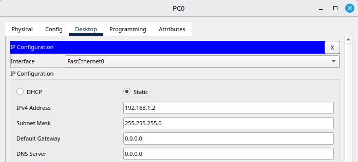
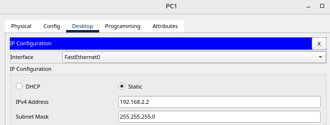

# 0. Objetivo de la práctica

En esta práctica realizamos un conjunto de pequeñas prácticas sobre distintos métodos de **seguridad lógica**: política de contraseñas, autenticación en dos pasos, listas de control de acceso, tolerancia a fallos de disco y copias de seguridad cifradas. Cada una corresponde a un documento teórico-práctico visto en clase.

## Partes de la práctica

| Práctica | Descripción |
| :--- | :--- |
| 1. Política de contraseñas | Instalación de la librería `libpam-cracklib` para impedir contraseñas débiles o de diccionario. |
| 2. Autenticación en 2 pasos | Configuración de Google Authenticator (PAM) en el servicio SSH y activación del 2FA con Microsoft Authenticator. |
| 3. ACLs en Linux | Asignación de permisos a un grupo de usuarios mediante `setfacl`. |
| 4. ACLs en un router | Configuración de una ACL numerada en un router con Packet Tracer. |
| 5. RAID 5 | Creación de un RAID 5 con `mdadm`, disco spare y simulación de fallo. |
| 6. Copias de seguridad | Copias completas, incrementales, con exclusiones y restauración cifradas con Duplicity. |

\newpage

# Práctica 1: Instalación de librería libpam_cracklib

Los sistemas basados en Linux, como Ubuntu, permiten crear una cuenta local con cualquier contraseña, incluso `123456`. Para obligar a todos los usuarios a utilizar contraseñas robustas instalamos **libpam-cracklib**, una librería PAM que comprueba que la nueva contraseña:

- No es igual a una anteriormente utilizada.
- No es una reutilización con un único carácter cambiado.
- No es demasiado corta ni poco compleja.
- No contiene un mismo carácter repetido de forma consecutiva.
- No forma parte de un diccionario de contraseñas comunes.

## 1.1. Política de contraseñas

Instalamos la librería:

```terminal
sudo apt install libpam-cracklib
```

La configuración se encuentra en `/etc/pam.d/common-password`. Antes de modificarlo hacemos una copia de seguridad del fichero y lo abrimos con permisos de superusuario:

```terminal
sudo cp /etc/pam.d/common-password /etc/pam.d/common-password.bak
sudo nano /etc/pam.d/common-password
```

Localizamos la línea del módulo `pam_cracklib.so` dentro del bloque *Primary* y la modificamos. Los parámetros disponibles son:

| **Opción** | **Significado** |
| :--- | :--- |
| `retry` | Número de intentos antes de que el sistema devuelva un error. |
| `minlen` | Longitud mínima de la contraseña. |
| `difok` | Número de caracteres que deben cambiar respecto a la contraseña anterior. |
| `ucredit` | Mayúsculas requeridas (valor negativo = mínimo obligatorio). |
| `lcredit` | Minúsculas requeridas. |
| `dcredit` | Dígitos requeridos. |
| `ocredit` | Símbolos (otros caracteres) requeridos. |

\newpage

Aplicamos las siguientes restricciones:

- Longitud mínima de 10 caracteres.
- Al cambiar la clave, mínimo tres caracteres diferentes.
- Mínimo 2 mayúsculas, 3 minúsculas, 3 dígitos y 1 símbolo.

La línea resultante queda así:

```bash
password requisite pam_cracklib.so retry=3 minlen=10 difok=3 ucredit=-2 lcredit=-3 dcredit=-3 ocredit=-1
```

\imagen[width=\linewidth]{fotos/img1.png}

\newpage

## 1.2. Creación de usuario

Creamos un usuario con nuestro nombre y lo añadimos al grupo del usuario principal (`mg`). Comprobamos los grupos a los que pertenece:

```terminal
sudo useradd davidmarco
sudo usermod -aG mg davidmarco
groups davidmarco
```

\imagen[width=0.8\textwidth]{fotos/img2.png}

Asignamos la shell y la carpeta personal del usuario, y le damos permisos sobre ella:

```terminal
sudo mkdir /home/davidmarco
sudo usermod --shell /bin/bash --home /home/davidmarco davidmarco
sudo chown davidmarco:davidmarco -R /home/davidmarco
```

Establecemos la contraseña del usuario. Al hacerlo, la política definida en el apartado anterior se aplica automáticamente. Una vez actualizada, iniciamos sesión con el nuevo usuario y ejecutamos `date`:

```terminal
sudo passwd davidmarco
su davidmarco
date
```

\imagen[width=0.8\textwidth]{fotos/img3.png}

A partir de este punto, todas las prácticas se realizan con este usuario.

\newpage

# Práctica 2: Proceso de autenticación en 2 pasos

La autenticación en dos pasos (2FA) añade un segundo factor de verificación a la contraseña. En esta práctica combinamos:

1. **Algo que sabes:** la contraseña del usuario.
2. **Algo que tienes:** un código de 6 dígitos que cambia cada 30 segundos y se genera en el móvil.

El servidor genera un secreto compartido que se transfiere al móvil mediante un código QR. A partir de ese momento, servidor y aplicación generan los mismos códigos a partir de la hora actual.

## 2.1. Configuración del servidor y del servicio SSH

### Sincronización de relojes

Para que el 2FA funcione, el reloj de la máquina y el del móvil deben estar sincronizados:

```terminal
sudo timedatectl set-timezone Europe/Madrid
date
```

### Instalación de paquetes

Instalamos el generador de códigos QR y el módulo PAM de Google Authenticator:

```terminal
sudo apt install qrencode
sudo apt install libpam-google-authenticator
```

### Integración con PAM

En Linux, las aplicaciones delegan la autenticación en la arquitectura **PAM** (*Pluggable Authentication Modules*), que actúa como una aduana modular. Indicamos a PAM que el servicio SSH debe usar Google Authenticator añadiendo una línea al final de `/etc/pam.d/sshd`:

```terminal
sudo nano /etc/pam.d/sshd
```

```bash
auth required pam_google_authenticator.so
```

\imagen[width=\linewidth]{fotos/img4.png}

### Habilitar PAM en SSH

Ahora el proceso es el inverso: indicamos al servicio SSH que la autenticación la gestione PAM. Editamos `/etc/ssh/sshd_config` y comprobamos que estas dos directivas están activas:

```terminal
sudo nano /etc/ssh/sshd_config
```

```bash
ChallengeResponseAuthentication yes
UsePAM yes
```

\imagen[width=\linewidth]{fotos/img5.png}

Reiniciamos el servicio para aplicar los cambios:

```terminal
sudo systemctl restart sshd
```

## 2.2. Activación del 2FA por el usuario

Con el usuario creado en la Práctica 1 ejecutamos:

```terminal
google-authenticator
```

El asistente pregunta si los tokens serán basados en tiempo (respondemos `y`) y muestra la **URL del código QR** (una dirección que empieza por `https://www.google.com/chart?...`).

\imagen[width=\linewidth]{fotos/img6.png}

A continuación, el asistente muestra la **llave secreta**, solicita un código de verificación de la aplicación y genera los códigos de emergencia. Al resto de preguntas respondemos que sí (`y`).

\imagen[width=0.8\textwidth]{fotos/img7.png}

## 2.3. Generación del código QR en PNG

El código QR que se dibuja en el terminal es ilegible, por lo que utilizamos `qrencode` para generar una imagen PNG a partir de la URL del código QR:

```terminal
qrencode -o codigo2fa.png "URL del código QR"
```

El archivo `codigo2fa.png` se crea en la carpeta personal del usuario:

\imagen[width=0.8\textwidth]{fotos/img8.png}

## 2.4. Vinculación con Microsoft Authenticator

Desde el móvil abrimos **Microsoft Authenticator**, pulsamos el botón de escaneo y capturamos el QR. También es posible usar la opción **Otra cuenta**, introduciendo un nombre de cuenta y la llave secreta manualmente. La aplicación pasa a mostrar un código de 6 dígitos que se renueva cada 30 segundos.

\imagen[width=0.5\textwidth]{fotos/img9.png}

Con esto el 2FA queda activado. Para comprobarlo, nos conectamos por SSH a la propia máquina:

```terminal
ssh davidmarco@localhost
```

El sistema solicita primero la contraseña del usuario y, a continuación, el código de verificación que muestra la aplicación en ese instante.

\newpage

# Práctica 3: Configuración de ACLs en Linux con setfacl

Los permisos tradicionales de Linux (propietario, grupo, otros) son limitados. Las **ACL** (*Access Control Lists*) permiten asignar permisos a usuarios o grupos concretos sin cambiar el propietario ni el grupo del archivo.

Creamos un archivo de prueba y damos permisos de lectura, escritura y ejecución al grupo `mg` con `setfacl`. Comprobamos el resultado con `getfacl`:

```terminal
touch pruebadavidmarco.txt
setfacl -m g:mg:rwx pruebadavidmarco.txt
getfacl pruebadavidmarco.txt
```

\imagen[width=0.9\textwidth]{fotos/img10.png}

La salida muestra los permisos base del archivo (`user`, `group`, `other`) y la nueva entrada `group:mg:rwx`. La **máscara** (`mask::rwx`) indica los permisos efectivos máximos que pueden tener las entradas ACL.

::: note
La opción `-m` modifica la ACL del archivo y el formato de la entrada es `tipo:nombre:permisos`, donde `g` indica grupo.
:::

\newpage

# Práctica 4: Configuración de ACLs en un router con Packet Tracer

El objetivo es configurar una ACL en un router para gestionar el tráfico de una red simulada: **bloqueamos una IP concreta de la Red 1 y permitimos el resto del tráfico**.

## 4.1. Esquema de red

| Elemento | Configuración |
| :--- | :--- |
| Router central | `gig0/0/0`: 192.168.1.1/24 · `gig0/0/1`: 192.168.2.1/24 |
| Red 1 | 192.168.1.0/24 (PC0: 192.168.1.2) |
| Red 2 | 192.168.2.0/24 (PC1: 192.168.2.2) |

## 4.2. Configuración básica del router

Desde la CLI del router configuramos las dos interfaces con sus direcciones IP y las activamos:

```bash
enable
configure terminal
interface gig0/0/0
ip address 192.168.1.1 255.255.255.0
no shutdown
exit
interface gig0/0/1
ip address 192.168.2.1 255.255.255.0
no shutdown
```

\imagen[width=\linewidth]{fotos/img11.png}

## 4.3. Configuración de los equipos

Asignamos direcciones IP estáticas dentro del rango de cada red.

::: {.grid cols=2}


:::

## 4.4. Configuración de la ACL

Creamos una ACL numerada que deniega el tráfico del host `192.168.1.4` y permite el resto:

```bash
access-list 1 deny 192.168.1.4 0.0.0.0
access-list 1 permit any
```

La aplicamos en sentido de entrada (`in`) a la interfaz conectada a la Red 1:

```bash
interface gig0/0/0
ip access-group 1 in
```

\imagen[width=\linewidth]{fotos/img14.png}

::: note
Una ACL estándar filtra únicamente por **dirección IP de origen**. Al final de toda ACL existe un `deny any` implícito, por lo que es necesario el `permit any` para no bloquear el resto de tráfico.
:::

## 4.5. Pruebas de funcionamiento

Realizamos pruebas de conectividad con `ping`: el tráfico entre equipos legítimos funciona correctamente, mientras que las peticiones asociadas a `192.168.1.4` agotan el tiempo de espera (*Request timed out*), con un 100 % de paquetes perdidos.

\imagen[width=\linewidth]{fotos/img15.png}

\newpage

# Práctica 5: RAID 5 con mdadm

Un **RAID 5** reparte los datos entre varios discos y añade información de **paridad** distribuida. Si un disco falla, los datos se reconstruyen con la información de los restantes. El **disco spare** es un disco de reserva que entra automáticamente a sustituir al que falla.

## 5.1. Creación de los discos virtuales

En VirtualBox añadimos al controlador SATA de la máquina cuatro discos de 5 GB para el RAID y, más adelante, un quinto disco para el spare.

## 5.2. Instalación de mdadm

```terminal
sudo apt install mdadm
```

\imagen[width=0.8\textwidth]{fotos/img16.png}

## 5.3. Identificación de los discos

Listamos los discos del sistema para identificar los nuevos (`sdb`, `sdc`, `sdd` y `sde`):

```terminal
sudo fdisk -l | more
```

\imagen[width=0.8\textwidth]{fotos/img17.png}

Además, utilizamos `lsblk`, que ofrece en una sola salida el nombre, tamaño y tipo de cada dispositivo:

```terminal
lsblk
```

## 5.4. Configuración de los discos

Preparamos cada disco con `fdisk`, creando una partición primaria que ocupa todo el disco:

```terminal
sudo fdisk /dev/sdb
```

\imagen[width=0.8\textwidth]{fotos/img18.png}

Repetimos el proceso en el resto de discos. Al listar de nuevo los discos se observan las particiones creadas:

\imagen[width=0.8\textwidth]{fotos/img19.png}

## 5.5. Creación del RAID 5

Creamos el array RAID 5 con los cuatro discos:

```terminal
sudo mdadm -Cv /dev/md0 -l5 -n4 /dev/sd{b,c,d,e}
```

| Opción | Significado |
| :--- | :--- |
| `-C` | Crear un nuevo array. |
| `-v` | Mostrar información detallada. |
| `-l5` | Nivel RAID 5. |
| `-n4` | Número de dispositivos activos. |

El sistema registra el dispositivo como `/dev/md127`. Los cuatro discos de 5 GB se convierten en un único volumen de unos 15 GiB, ya que el equivalente a un disco se reserva para la paridad.

\imagen[width=0.8\textwidth]{fotos/img20.png}

## 5.6. Verificación del estado del RAID

```terminal
cat /proc/mdstat
```

La salida muestra el RAID 5 activo con los cuatro discos y el estado `[UUUU]`, que indica que los cuatro dispositivos funcionan correctamente.

\imagen[width=\linewidth]{fotos/img21.png}

## 5.7. Formateo del volumen

Damos formato `ext3` al dispositivo RAID para poder almacenar archivos:

```terminal
sudo mkfs.ext3 /dev/md127
```

\imagen[width=\linewidth]{fotos/img22.png}

## 5.8. Creación del disco spare

Añadimos en VirtualBox un quinto disco (`spare.vdi`) al controlador SATA de la máquina.

\imagen[width=0.8\textwidth]{fotos/img23.png}

Lo incorporamos al RAID como disco de reserva. Al haber ya cuatro discos activos, `mdadm` lo mantiene en espera:

```terminal
sudo mdadm /dev/md127 --add /dev/sdf
```

## 5.9. Simulación de fallo de un disco

Marcamos uno de los discos del RAID como fallido para comprobar el comportamiento del sistema:

```terminal
sudo mdadm /dev/md127 --fail /dev/sde
sudo mdadm -D /dev/md127
```

`mdadm` aparta el disco fallido, activa el spare (`/dev/sdf`) y comienza a reconstruir en él los datos a partir de la paridad. En la salida de `mdadm -D` se observa:

1. El estado inicial: 5 dispositivos totales, 4 activos y 1 spare.
2. Durante la reconstrucción: estado `clean, degraded, recovering`, 1 dispositivo fallido (`/dev/sde`) y el progreso (*Rebuild Status*).
3. Al finalizar: 4 dispositivos activos, 1 fallido y 0 spare.

\imagen[width=0.8\textwidth]{fotos/img24.png}

Por último, comprobamos de nuevo el estado en `/proc/mdstat`: el disco `sde` aparece marcado con `(F)` y el RAID vuelve a mostrar `[UUUU]`.

```terminal
sudo cat /proc/mdstat
```

\imagen[width=\linewidth]{fotos/img25.png}

::: tip
Gracias al disco spare, el RAID recupera automáticamente la redundancia tras el fallo y no se pierden datos.
:::

\newpage

# Práctica 6: Copias de seguridad con Duplicity

**Duplicity** es una herramienta de copias de seguridad para Ubuntu. Guarda los archivos en formato `.tar`, con la opción de cifrarlos mediante **GPG**, y permite copias completas e incrementales.

## 6.1. Preparación del escenario

Trabajamos sobre la carpeta `Documentos` de nuestro directorio personal. Creamos en ella 20 archivos con nuestro nombre y comprobamos que se han generado:

```terminal
cd Documentos
touch davidmarco{1..20}.txt
ls
```

\imagen[width=\linewidth]{fotos/img26.png}

Creamos también el directorio donde se guardará la copia y le asignamos permisos de escritura:

```terminal
mkdir backup
sudo chmod 777 backup
```

## 6.2. Instalación de Duplicity

Actualizamos el sistema e instalamos Duplicity junto con sus dependencias. Verificamos que GPG está disponible:

```terminal
sudo apt update
sudo apt upgrade
sudo apt install duplicity haveged python3-boto
gpg --version
```

## 6.3. Copia de seguridad completa

Indicamos a Duplicity el origen y el destino, este último en formato URL:

```terminal
duplicity /home/mg/Documentos file:///home/mg/backup
date
```

El comando solicita una **contraseña de cifrado**. Es imprescindible recordarla, ya que sin ella no es posible restaurar los datos. Al finalizar se muestran las estadísticas de la copia.

\imagen[width=\linewidth]{fotos/img27.png}

Listamos el contenido del directorio `backup`:

```terminal
ls backup
```

\imagen[width=\linewidth]{fotos/img28.png}

::: note
Los archivos tienen extensión `.gpg`, lo que indica que están **cifrados**. La palabra `full` en el nombre indica que se trata de una copia **completa**.
:::

## 6.4. Copia de seguridad incremental

Una copia incremental guarda únicamente lo que ha cambiado desde la última copia. Basta con añadir la opción `incremental` al comando:

```terminal
duplicity incremental /home/mg/Documentos file:///home/mg/backup
ls backup/
```

\imagen[width=\linewidth]{fotos/img29.png}

En el directorio de destino se observan ahora los archivos de la copia completa y los de la incremental (`duplicity-inc...`).

\imagen[width=\linewidth]{fotos/img30.png}

## 6.5. Restauración de datos

Para restaurar, indicamos a Duplicity el directorio donde está la copia y el directorio de destino. Desde la carpeta personal:

```terminal
mkdir restore
duplicity file:///home/mg/backup /home/mg/restore
ls restore/
```

Se solicita la contraseña de descifrado y los archivos quedan restaurados en `restore`.

\imagen[width=\linewidth]{fotos/img31.png}

## 6.6. Copias excluyendo contenido

Para excluir parte del contenido, vaciamos primero los directorios `backup` y `restore` y creamos dentro de `Documentos` una carpeta `Borradores` con diez archivos:

```terminal
cd backup/
rm *.*
cd ../restore/
rm *.*
cd ../Documentos/
mkdir Borradores
cd Borradores/
touch borrador{1..10}.txt
ls
date
```

\imagen[width=\linewidth]{fotos/img32.png}

Realizamos la copia de seguridad excluyendo el directorio `Borradores` con la opción `--exclude`:

```terminal
duplicity --exclude /home/mg/Documentos/Borradores /home/mg/Documentos file:///home/mg/backup
```

\imagen[width=\linewidth]{fotos/img33.png}

Restauramos la copia y listamos los archivos recuperados, entre los que no se encuentran los de `Borradores`:

```terminal
ls restore/
```

\imagen[width=\linewidth]{fotos/img34.png}

::: tip
De forma análoga a `--exclude`, la opción `--include` permite añadir directorios concretos a la copia y construir copias más complejas.
:::
